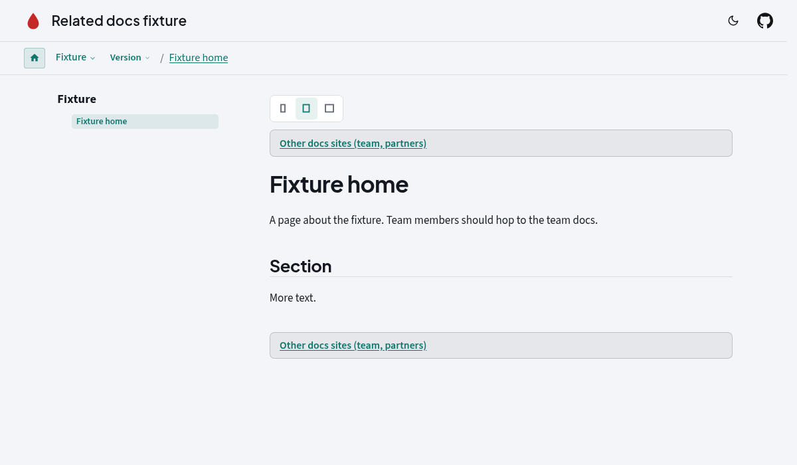

= Related Docs
:description: Antora extension that links every page to an org's other docs sites through a generated registry page.
:page-orig-author: Ryan Johnson
:page-last-edited: 2026-10-23

**Related Docs** stops new readers from wandering lost on the wrong docs site. It generates a registry page that lists every docs site your org publishes (public hub, team docs, partner portal, ...) and bakes a slim link to it at the top and/or bottom of every page. Orgs with no other sites say so explicitly with `sites: none`, so the extension can ship in a default stack without showing anything.

Support: support@devcentr.org

== Install

[source,bash]
----
pnpm add -D github:antora-supplemental/related-docs#v0.1.0
----

Already on `@antora-supplemental/facto-stack` v0.2.65 or later? It is bundled; configure it with the pack key `relatedDocs` (see <<facto-stack>>).

== Quick start

[source,yaml]
----
antora:
  extensions:
    - require: '@antora-supplemental/related-docs'
      label: Team docs (members only)
      description: Internal runbooks and onboarding live on the team site.
      sites:
        - name: FTN Team Docs
          url: https://team.docs.foodtrucknerdz.com
          audience: team
          requires_login: true
          login_note: GitHub sign-in with FoodTruckNerdz org membership
----

Result: every page gets a link at the top of the article and at its end, pointing to a generated `<start-page component>::related-docs.adoc` page (`/docs/related-docs/` with indexify URLs) that lists the sites.

== Configuration

Write keys in snake_case, the Antora playbook convention (Antora lowercases camelCase keys inside extension config). Programmatic callers such as facto-stack may pass camelCase.

[cols="1,1,3",options="header"]
|===
|Key |Default |Meaning

|`sites`
|_(missing)_
|List of sites, or `none` for an explicit opt-out. Missing or empty: element hidden and one `info` log line suggests `sites: none`.

|`sites[].name` / `url`
|required
|Display name; absolute `http(s)` URL or root-relative path.

|`sites[].audience`
|`other`
|Free text; conventional values `public`, `team`, `partners`, `customers`, `internal`. `audience_label` overrides the display text.

|`sites[].description`
|empty
|One line on what the site covers.

|`sites[].requires_login` / `login_note`
|`false` / empty
|Shows "Login required" (plus the note) on the registry page.

|`data_file`
|none
|YAML or JSON file (relative to the playbook) with a list of sites or `{ sites: [...] }`; merged after inline `sites`.

|`label` / `description`
|`Related docs sites` / empty
|Link text and optional trailing sentence for both placements.

|`top`, `footer`
|`true`
|`false` hides that placement. Object form: `{ enabled, position, label, description }`. `top.position`: `article` (start of `article.doc`) or `body`. `footer.position`: `article` (end of `article.doc`), `site-footer` (inside `footer.footer`) or `body`.

|`index`
|enabled
|`false` skips the registry page. Object: `{ component, version, module: ROOT, path: related-docs, title, intro }`. Component defaults to the `site.start_page` component. A real page at that path wins over the generated one.

|`link_url`
|none
|Override the link target (root-relative or absolute), e.g. a hand-written page when `index: false`.

|`direct_link_when_single`
|`false`
|With exactly one site, link straight to it instead of the registry page.

|`explicit_none`
|`false`
|Same as `sites: none` (useful when a templated list is empty on purpose).
|===

=== Explicit opt-out

[source,yaml]
----
    - require: '@antora-supplemental/related-docs'
      sites: none
----

=== Three-site org

[source,yaml]
----
    - require: '@antora-supplemental/related-docs'
      label: Other docs sites
      footer: { position: site-footer }
      sites:
        - { name: Public docs, url: https://docs.example.org, audience: public }
        - { name: Team handbook, url: https://team.docs.example.org, audience: team, requires_login: true, login_note: SSO }
        - { name: Partner portal, url: https://partners.example.org, audience: partners, description: Integration APIs and SLAs, requires_login: true }
----

== Styling

The element is `<aside class="related-docs related-docs--top|footer" data-related-docs="top|footer">`. Its defaults derive from `currentColor`, so it follows Valentus and default-UI light/dark themes without extra CSS. Override with custom properties:

`--related-docs-bg`, `--related-docs-border`, `--related-docs-fg`, `--related-docs-link`, `--related-docs-radius`, `--related-docs-padding`, `--related-docs-margin`, `--related-docs-footer-margin`, `--related-docs-font-size`.

[[facto-stack]]
== With facto-stack

facto-stack registers this extension by default. With no `relatedDocs` config it stays hidden and logs one hint. Configure through the pack:

[source,yaml]
----
    - require: '@antora-supplemental/facto-stack'
      relatedDocs:
        sites: none          # or a list as above
----

== Develop

[source,bash]
----
pnpm install
pnpm test            # unit tests + fixture Antora build
pnpm build:fixture   # build/fixture/
----

Docs component: `docs/` (aggregated by the antora-supplemental docs hub). Changelog: link:CHANGELOG.adoc[].

== License

MIT
